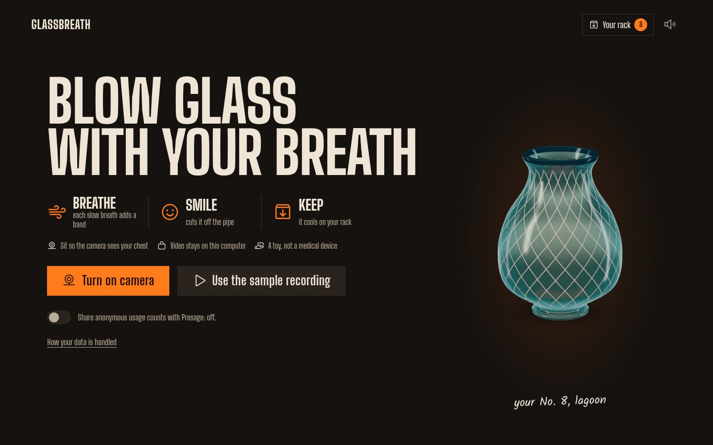
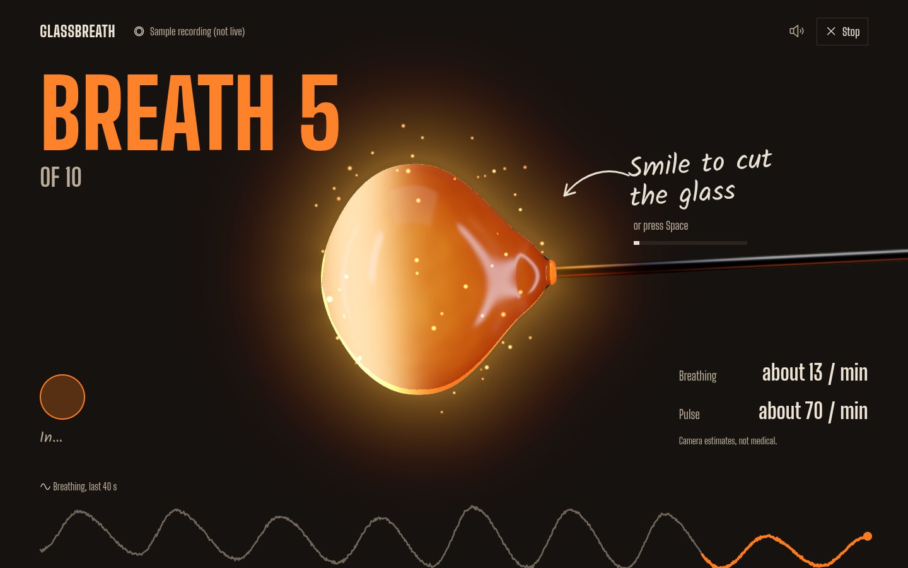
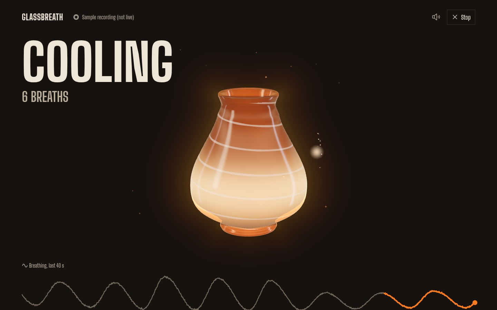
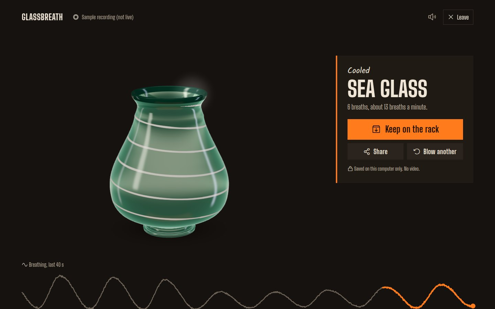
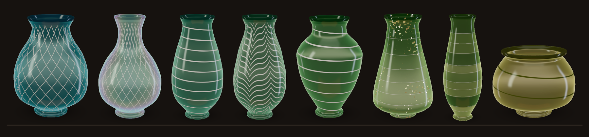
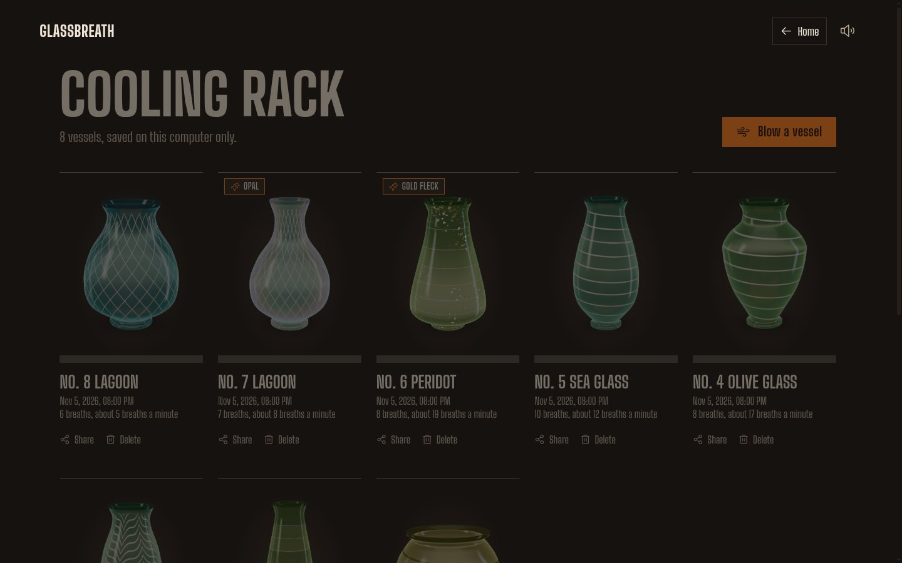

# Glassbreath

**Blow a glass vessel with your own breathing.**

A desktop app that watches your chest rise and fall through the webcam, using the [Presage SmartSpectra SDK](https://physiology.presagetech.com/), and turns every slow breath into a band of molten glass. Smile to cut it off the pipe, watch it cool, and keep it on your rack.

[Watch the 2-minute demo](https://youtu.be/5Io4VdRcKS4) · [Download v0.1.1](https://github.com/Sarcastic-Soul/glassbreath/releases/tag/v0.1.1) for Linux, Windows or macOS. No webcam? The built-in sample recording runs the whole thing.



## How it works

| Breathe | Smile | Keep |
|---|---|---|
|  |  |  |
| Each slow breath adds a band to the hot glass. A deep breath makes a wide band, a short one makes a narrow neck. | Hold a smile (or press Space) to cut the glass off the pipe. It cools into a colour picked from your breathing pace. | Keep it on the "Cooling rack", a small gallery saved on your computer only. |

## Every breath leaves a mark



Your breathing decides the whole finished vessel:

- **Shape.** Deep breaths give a fuller belly, more breaths make it taller, deepening or easing breaths move the widest point up or down, and long out-breaths give a longer neck.
- **Colour.** Slow breathing cools into teal and sea glass, quicker breathing into olive, peridot, straw and honey.
- **Pattern.** Steady breaths get a white thread wrapped once per breath or a fine Venetian-style lattice (filigrana). Uneven depth gets combed feather waves. A varied pace gets coloured bands, one per breath (incalmo).
- **Rare finish.** About one vessel in eight cools with gold fleck, crackle or opal.

The row above, left to right, was blown from sample breathing:

| Breathing | Vessel |
|---|---|
| 5 deep breaths a minute | Lagoon, filigrana lattice |
| 8 a minute, long out-breaths | Lagoon, filigrana, opal finish |
| 12 a minute, steady | Sea glass, white thread |
| 15 a minute, uneven depth | Jade, feather combing |
| 17 a minute, deepening | Olive glass, white thread |
| 19 a minute, easing off | Peridot, coloured bands, gold fleck |
| 20 a minute, quick and shallow | Peridot, coloured bands |
| 24 a minute, three big breaths | Straw, white thread |

## Your rack



The home screen turns your recent vessels (or a few sample ones on a fresh install). Drag any finished vessel to tumble it in 3D, flick it to keep it rolling, scroll to zoom, and double-click to stand it back up. On the rack, press "Turn in 3D" on a vessel to pick it up the same way. The rack keeps each one with its name, date and breath count, plus calm achievements such as "Slow breather" or collecting all six glass colours. None of them reward breathing faster.

Press "Share" to make a picture card of your vessel (name, breath count, and your breathing pace only if you switch it on). You can copy it, save it, or open a post on X or Bluesky with the picture ready to paste.

Sounds are made in code: furnace roar, a glass tink for each band, a chime when you cut, cooling crackle.

It is a toy and a slow-breathing exercise, not a health tool. The numbers on screen are rough camera estimates.

## Download

Get the latest build from the [Releases page](https://github.com/Sarcastic-Soul/glassbreath/releases):

| System | File | Notes |
|---|---|---|
| Linux (x64) | `.deb` or `.AppImage` | The `.deb` is the safest choice (`sudo apt install ./Glassbreath-*.deb`). |
| Windows 10/11 (x64) | `.exe` installer | The build is not code-signed, so SmartScreen may warn: press "More info", then "Run anyway". |
| macOS (Apple Silicon) | `.dmg` | Not notarized. The first time, right-click the app and choose Open. If macOS says it is damaged, run `xattr -cr /Applications/Glassbreath.app`. Intel Macs are not supported by the SDK. |

On first use, press "Turn on camera" and paste your Presage API key (free at <https://physiology.presagetech.com/>). It is saved on your computer only, encrypted with your system keychain where one is available. "Use the sample recording" works without a key.

Builds are made by GitHub Actions (`.github/workflows/release.yml`) on every push; pushing a tag like `v0.2.0` publishes a release.

## How the SDK is used

| SmartSpectra output | What it does in Glassbreath |
|---|---|
| `breathing.upperTrace` (about 29 samples a second, about 60 ms delay) | Shapes the glass live. Each breath is cut into inhale and exhale, and its depth sets the width of the next band. |
| `breathing.rate` | Shown as "about N / min" and picks the cooled glass colour (slow breathing gives teal and sea glass, faster gives honey and amber). |
| `cardio.pulseRate` and `arterialPressureTrace` | A soft glow pulse in the hot glass, timed to your heartbeat. |
| `face.expression` (happiness score) | Holding a smile for under a second cuts the glass off the pipe. |
| `face.talking` | Talking pauses the glass, so speech does not get blown into the shape. |
| Validation status and hints | The glass freezes and the SDK's hint ("Place more of the chest in view", and so on) is shown while the picture is not good enough. |

## Requirements

- Linux, macOS or Windows with a webcam. Tested on Ubuntu with Node 22.
- Node.js 20 or newer.
- A Presage API key from <https://physiology.presagetech.com/>.

## Setup

```sh
git clone <this repo>
cd glassbreath
npm install
cp .env.example .env
# then put your key in .env:  SMARTSPECTRA_API_KEY=...
npm start
```

### Linux: Electron sandbox

On some Linux systems Electron stops with "The SUID sandbox helper binary was found, but is not configured correctly". Fix it once after `npm install`:

```sh
sudo chown root:root node_modules/electron/dist/chrome-sandbox
sudo chmod 4755 node_modules/electron/dist/chrome-sandbox
```

You need to do this again after reinstalling Electron. Please don't run the app with `--no-sandbox`.

## Running

| Command | What it does |
|---|---|
| `npm start` | Build and open the app. |
| `npm run start:debug` | Same, with DevTools open. |
| `npm run playground` | Glass engine on its own with sliders, no camera. |
| `npm test` | Unit tests for the signal processing and vessel shape. |
| `npm run cameras` | List the cameras the SDK can see. |
| `npm run probe` | Measure how often and how late each metric arrives. |
| `npm run dist` | Package installers for this system into `out/` (electron-builder). |
| `npm run record -- fixtures/my-session.jsonl` | Record a real session (metrics only, no video) for replay. Set `RECORD_SECONDS` to change the length (default 90). |

### No camera? Use the sample recording

The consent screen has a "Use the sample recording" button. It plays back a recorded stream of SDK metrics, so you can see the whole flow without a webcam or API key. The app labels this clearly as "Sample recording (not live)", and vessels made from it are marked on the rack. If `fixtures/sample-session.jsonl` exists it is used, otherwise the synthetic `fixtures/synthetic-session.jsonl`.

## Privacy and data handling

- **Consent first.** The camera only turns on after you press "Turn on camera". "Stop" (or "Finish" once a vessel is kept) turns it off, and so does closing the app.
- **On this computer.** The SmartSpectra SDK processes video frames locally. Frames are never uploaded or saved.
- **Network.** The SDK contacts Presage to check the API key.
- **Usage counts are off by default.** The consent screen has a switch for the SDK's anonymous telemetry (one summary per session: SDK version, OS, frame counts, error codes; never video or readings). It stays off unless you turn it on.
- **Your API key.** If you paste it in the app, it is stored in the app's user data folder, encrypted with the system keychain when available.
- **Achievements.** A small progress file (which achievements and colours you have) is saved locally. Deleting vessels does not reset it.
- **What is stored.** Nothing, unless you press "Keep on the rack". Then a PNG of the vessel and its shape (band widths, colour, breath count, rounded breathing pace) are saved in the app's user data folder. Pulse is not stored. Delete one vessel or all of them from the rack.
- **Sharing is manual.** Nothing is posted for you. "Share" builds a picture card on this computer. Copy, save and post only happen when you press those buttons, and posting just opens the site in your browser with suggested text. Breathing pace is left off the card unless you turn it on; pulse is never on it.
- **Not medical.** Breathing and pulse are estimates used to shape art. Glassbreath does not diagnose, treat or advise on anything.

## Project layout

```
src/main/main.cjs        Electron main: window, camera permission, key from .env, gallery files
src/preload/preload.js   SDK bridge plus a small window.glassbreath API
src/renderer/app.js      Screens and session flow
src/renderer/signals/    SDK wrapper: breath phases, beats, smile, talking, replay
src/renderer/glass/      three.js vessel: lathe geometry, glass material, cut and cool
src/renderer/ui/         Breathing trace, rack, vessel names
scripts/                 Probe, record and fixture tools
fixtures/                Recorded metric streams for replay
```

## Credits

- [Presage SmartSpectra SDK](https://github.com/Presage-Security/SmartSpectra) for breathing, pulse and face metrics.
- [three.js](https://threejs.org/) for the glass.
- Fonts: Big Shoulders Display and Big Shoulders Text (Patric King), Kalam (Indian Type Foundry), via Fontsource. Icons: [Phosphor](https://phosphoricons.com/).

## License

MIT. See [LICENSE](LICENSE). The SmartSpectra SDK has its own license.
